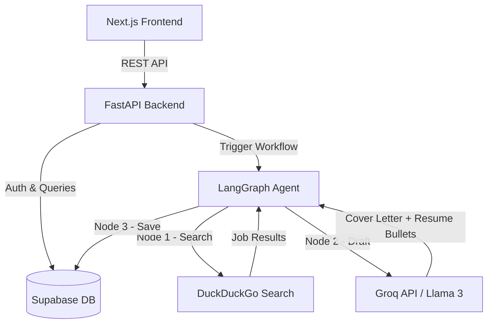

# System Architecture

## High-Level Overview



## Module Breakdown

| Module | Layer | Status | Description |
|--------|-------|--------|-------------|
| 1 | Infra | ✅ Done | Project setup, directory structure |
| 2 | Infra | ✅ Done | Supabase schema (profiles, jobs, applications) |
| 3 | Infra | ✅ Done | Environment variables + `.gitignore` |
| 4 | Backend | ✅ Done | LangGraph agent: search → draft → save |
| 5 | Backend | 🏃 Next | FastAPI REST routes + auth middleware |
| 6 | Frontend | ⬜ Planned | Supabase Auth in Next.js |
| 7 | Frontend | ⬜ Planned | Dashboard UI (Kanban + profile) |
| 8 | Automation | ⬜ Planned | Playwright form submission |

## Data Flow (Module 4 — Agent)

```
User Input (keywords, location, resume)
    │
    ▼
[search_jobs node]
    │ DuckDuckGo query
    │ Max 5 results, 3× retry with back-off
    ▼
[draft_documents node]
    │ Groq / llama3-8b-8192
    │ → Cover Letter (3 paragraphs, ≤300 words)
    │ → Tailored Resume Bullets (3 bullets)
    ▼
[save_to_database node]
    │ Supabase upsert on jobs.url (UNIQUE)
    ▼
AgentState returned to caller (FastAPI / test)
```

## File Structure

```
backend/
├── agent.py          # LangGraph agent (Module 4)
├── main.py           # FastAPI app (Module 5 stub)
└── test_agent.py     # Unit + smoke + integration tests

frontend/             # Next.js (Modules 6–7)
schema.sql            # Supabase table definitions (Module 2)
.env                  # Secrets (gitignored)
```
