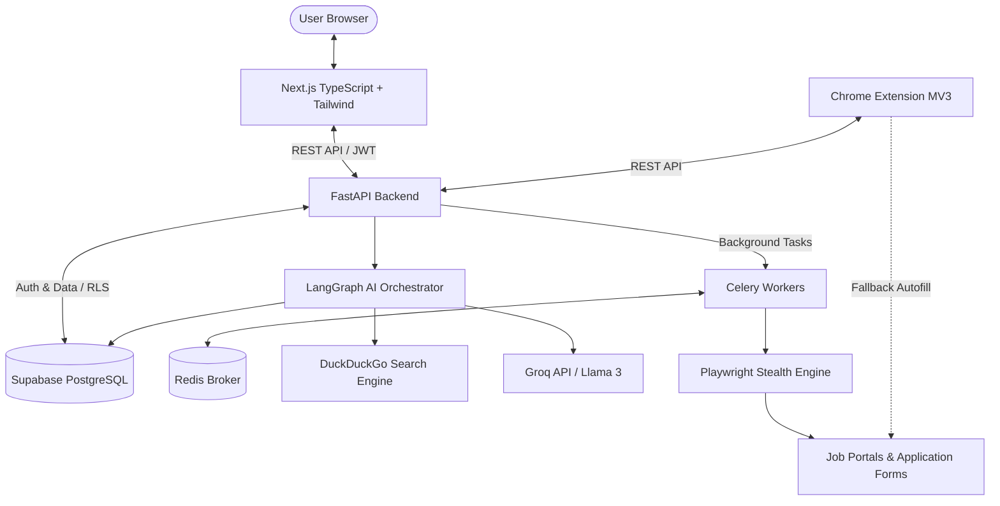

# System Architecture — Job Application Assistant (SaaS)

> **Approved Architecture Blueprint**
> Based on competitive research (Simplify, Teal, Jobscan, LazyApply) and production SaaS patterns.
> Approved: 2026-10-11

---

## 1. High-Level System Architecture



---

## 2. Four-Pillar Core Flow

```
┌─────────────────┐     ┌─────────────────┐     ┌─────────────────┐     ┌─────────────────┐
│   1. SEARCH     │ ──> │    2. SCORE     │ ──> │   3. TAILOR     │ ──> │   4. SUBMIT     │
│ DuckDuckGo API  │     │ TF-IDF + Cosine │     │ Groq / Llama 3  │     │ Human Review +  │
│ 10+ Portals     │     │ Skill Matching  │     │ Resume & Cover  │     │ Playwright Auto │
└─────────────────┘     └─────────────────┘     └─────────────────┘     └─────────────────┘
```

---

## 3. Component Breakdown

### 3.1 Frontend (`frontend/`)
- **Framework**: Next.js 14+ (App Router), TypeScript, Tailwind CSS, shadcn/ui.
- **State & Data**: Supabase SSR Auth, SWR / React Query, `@dnd-kit` for Kanban board.
- **Key Modules**:
  - `(auth)`: Login & Signup with OAuth (Google, LinkedIn).
  - `onboarding`: Multi-step profile setup & resume parser upload.
  - `dashboard`: Kanban tracking (Found / Applied / Interview / Offer / Rejected).
  - `review/[id]`: Side-by-side human-in-the-loop application review before submission.
  - `billing`: Stripe customer portal and subscription management.

### 3.2 Backend API (`backend/`)
- **Framework**: FastAPI (Async) + Uvicorn.
- **Structure**:
  - `routers/`: Modular route handlers (`auth`, `jobs`, `applications`, `profile`, `subscriptions`, `interview`).
  - `services/`: Encapsulated business logic (`agent_service`, `match_service`, `resume_parser`, `stripe_service`).
  - `dependencies.py`: Supabase JWT auth verification (`get_current_user`), tier authorization (`require_pro_tier`).
  - `config.py`: Environment validation using `pydantic-settings`.

### 3.3 AI & Orchestration (`backend/agent.py`)
- **Engine**: LangGraph state machine.
- **Workflow**:
  ```
  search_jobs ──> draft_documents ──> detect_missing_fields
                    ──> [HUMAN INTERRUPT REVIEW] ──> save_to_database ──> END
  ```
- **Models**: Groq (`llama3-8b-8192`) for sub-second document drafting.

### 3.4 Automation & Workers (`backend/workers/`)
- **Queue**: Celery with Redis broker for asynchronous job handling.
- **Engine**: Playwright Chromium with `playwright-stealth` and dynamic field detection mapping.
- **Safety**: CAPTCHA detection pauses automation and alerts user.

### 3.5 Database & Auth (`Supabase`)
- **PostgreSQL**: Multi-tenant isolation using Row Level Security (RLS) policies on all tables.
- **Tables**: `profiles`, `jobs`, `applications`, `subscriptions`, `automation_logs`, `interview_sessions`, `notifications`.
- **Storage**: Screenshot audit trails stored in Supabase Storage (`automation-screenshots`).

---

## 4. Repository Structure

```
/
├── AGENTS.md                  # Complete AI & developer handoff guide
├── Architecture.md            # Approved system architecture (this file)
├── Project_Tracker.md         # Active progress & task tracker
├── schema.sql                 # Supabase PostgreSQL DDL + RLS policies
├── requirements.txt           # Python dependencies
│
├── backend/
│   ├── main.py                # FastAPI app factory
│   ├── config.py              # Pydantic settings
│   ├── dependencies.py        # Auth & subscription dependencies
│   ├── agent.py               # LangGraph pipeline
│   ├── routers/               # Route endpoints
│   ├── services/              # Business logic services
│   ├── workers/               # Celery + Playwright automation
│   └── tests/                 # Pytest test suite
│
├── frontend/                  # Next.js App Router application
└── extension/                 # Chrome Extension Manifest V3
```
