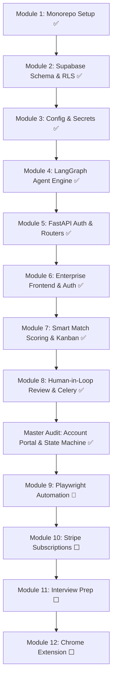

# Development Plan — JobPilot SaaS

> **Status:** Active Execution 🏃  
> **Current Focus:** Modules 1–8 & Audit Upgrade Complete ✅ → Transitioning to Module 9 (Playwright Headless Automation Engine)  
> **Source of Truth:** [AGENTS.md](file:///D:/Personal%20Projects/Automated%20Job%20Application/AGENTS.md)

---

## 🎯 Milestone Overview

---

## 📋 Detailed Module Execution Matrix

### ✅ Phase 1: Core Foundation & Agent (Modules 1 – 4)
- [x] **Monorepo Architecture**: Clean separation between Next.js frontend and FastAPI backend.
- [x] **Database & Security**: Supabase tables (`profiles`, `jobs`, `applications`, `subscriptions`, `automation_logs`, `interview_sessions`, `notifications`) with RLS enabled.
- [x] **Agent State Machine**: LangGraph pipeline connecting DuckDuckGo search (with 3-attempt exponential back-off) and Groq Llama 3 document tailoring.
- [x] **Core Test Layer**: 18 unit, smoke, and integration tests passing cleanly.

### ✅ Phase 2: Backend REST Architecture (Module 5)
- [x] **Pydantic Settings**: Validated environment configuration via `backend/config.py`.
- [x] **JWT Authentication**: `get_current_user` dependency in `backend/dependencies.py` verifying Supabase tokens.
- [x] **Modular Routers**: `auth.py`, `jobs.py`, `applications.py`, and `profile.py`.
- [x] **Resume Parser Service**: Support for `.pdf`, `.docx`, and `.txt` files via `pdfminer.six` and `python-docx`.
- [x] **Expanded Test Suite**: 40 tests passing across all endpoints (`pytest -v`).

### ✅ Phase 3: Enterprise Frontend & Identity (Module 6)
- [x] **Zero-Trust Middleware**: `frontend/src/middleware.ts` protecting all `/dashboard/**`, `/onboarding`, and private routes with automatic query redirect.
- [x] **SSO OAuth Integration**: Google & GitHub Single Sign-On via Supabase Auth.
- [x] **Registration & OTP Flow**: 6-digit confirmation code verification with resend cooldown timers.
- [x] **Credential Recovery**: Full `/forgot-password` and `/reset-password` self-service pages.
- [x] **Design & Branding**: Official JobPilot logo, custom 404 page, and high-conversion hero landing page.
- [x] **Zero Hydration Errors**: Full Next.js production build passing with 0 errors (`npm run build`).

### ✅ Phase 4: Job Dashboard & Semantic Match Scoring (Module 7)
- [x] **Vector Storage (pgvector)**: Enable pgvector extension, dense embeddings `vector(384)`, and HNSW cosine index in Supabase PostgreSQL.
- [x] **Semantic Match Scorer**: Sentence-BERT (`all-MiniLM-L6-v2`) dense vectorization and cosine similarity matching between candidate resumes and job postings.
- [x] **Missing Skills Detection**: LangGraph `detect_missing_skills` node identifying skill gaps between candidate profile and JD with semantic similarity thresholding.
- [x] **Live Kanban Pipeline**: 5-column drag-and-drop board (Discovered, Applied, Interview, Offer, Rejected) powered by `@dnd-kit` with optimistic updates.
- [x] **Job Search Filter UI**: Real-time keyword, location, and portal filtering with `sort=match_score`.

### ✅ Phase 5: Human-in-Loop Review & Celery Workers (Module 8)
- [x] **Celery App & Tasks**: `backend/workers/celery_app.py` and `automation_task.py`.
- [x] **Interactive Review Studio**: Side-by-side JD comparison, Llama 3 cover letter and bullet point editing.
- [x] **Review API Endpoints**: `/review`, `/approve`, and `/logs`.
- [x] **Missing Fields Quick-Fix**: In-place profile data collection.

### ✅ Phase 6: Master Audit & Account-Portal Upgrade (Audit Phase)
- [x] **Database Schema Reconciled**: Canonical `cover_letter` and `tailored_resume` columns backfilled; `UNIQUE(user_id, job_id)` constraint applied; structured profile preferences persisted.
- [x] **Separation of Pipeline Save vs External Submission**: `POST /applications/apply` saves to pipeline as `Found` / `discovered` without false claims of external submission (`applied_at=None`).
- [x] **Review & Approval Segregation**: `/review` exclusively updates draft text; `/approve` validates drafts exist before dispatching worker.
- [x] **Worker Honesty**: Removed fake `submitted` logs; un-automated portals transition to `manual_required`.
- [x] **Server-Side Account Purge**: `DELETE /auth/account` endpoint with cascade database deletion and Supabase Auth admin user purge.
- [x] **Unified Application Layout**: `AuthenticatedAppLayout` with shared sidebar, mobile drawer, unread notification counter, and account purge modal.
- [x] **Honest Manual Fallback**: `POST /applications/{id}/manual-complete` and interactive confirmation dialog.
- [x] **Full Suite Verification**: 60/60 backend tests passing; 14/14 Next.js routes building cleanly.

### 🏃 Phase 7: Playwright Automation Engine (Module 9 — Up Next)
- [ ] **Playwright & Stealth Setup**: Headless browser execution with `playwright-stealth`.
- [ ] **Form Filling Engine**: Semantic field mapping across standard application portals (Greenhouse, Lever, Workday).
- [ ] **Audit Trail Capture**: Screenshots stored to Supabase Storage bucket `automation-screenshots`.
- [ ] **CAPTCHA Handling**: Non-destructive pause with candidate notification.

---

## 🔒 Security & Quality Standards

1. **Pure Key Isolation**: No private keys (Stripe secret, Groq key, Supabase service key) are ever bundled into frontend artifacts.
2. **Backdoors Closed**: Direct URL navigation to protected screens without an authenticated Supabase session is strictly redirected to `/login`.
3. **Automated Verification**: Every new module requires automated test coverage and clean production builds before approval.
