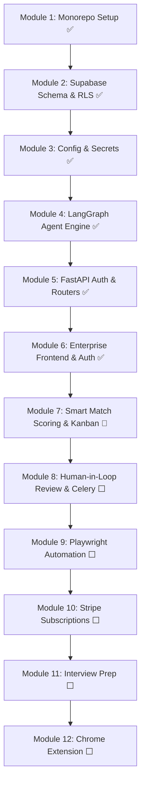

# Development Plan — JobPilot SaaS

> **Status:** Active Execution 🏃  
> **Current Focus:** Module 6 Complete ✅ → Transitioning to Module 7 (Smart Match Scoring & Kanban Board)  
> **Source of Truth:** [AGENTS.md](file:///D:/Personal%20Projects/Automated%20Job%20Application/AGENTS.md)

---

## 🎯 Milestone Overview

---

## 📋 Detailed Module Execution Matrix

### ✅ Phase 1: Core Foundation & Agent (Modules 1 – 4)
- [x] **Monorepo Architecture**: Clean separation between Next.js frontend and FastAPI backend.
- [x] **Database & Security**: Supabase tables (`profiles`, `jobs`, `applications`, `subscriptions`, `automation_logs`, `interview_sessions`, `notifications`) with RLS enabled.
- [x] **Agent State Machine**: LangGraph pipeline connecting DuckDuckGo search (with 3-attempt exponential back-off) and Groq Llama 3 document tailoring.
- [x] **Core Test Layer**: 18 unit, smoke, and integration tests passing cleanly.

### ✅ Phase 2: Backend REST Architecture (Module 5)
- [x] **Pydantic Settings**: Validated environment configuration via `backend/config.py`.
- [x] **JWT Authentication**: `get_current_user` dependency in `backend/dependencies.py` verifying Supabase tokens.
- [x] **Modular Routers**: `auth.py`, `jobs.py`, `applications.py`, and `profile.py`.
- [x] **Resume Parser Service**: Support for `.pdf`, `.docx`, and `.txt` files via `pdfminer.six` and `python-docx`.
- [x] **Expanded Test Suite**: 40 tests passing across all endpoints (`pytest -v`).

### ✅ Phase 3: Enterprise Frontend & Identity (Module 6)
- [x] **Zero-Trust Middleware**: `frontend/src/middleware.ts` protecting all `/dashboard/**`, `/onboarding`, and private routes with automatic query redirect.
- [x] **SSO OAuth Integration**: Google & GitHub Single Sign-On via Supabase Auth.
- [x] **Registration & OTP Flow**: 6-digit confirmation code verification with resend cooldown timers.
- [x] **Credential Recovery**: Full `/forgot-password` and `/reset-password` self-service pages.
- [x] **Design & Branding**: Official JobPilot logo, custom 404 page, and high-conversion hero landing page.
- [x] **Zero Hydration Errors**: Full Next.js production build passing with 0 errors (`npm run build`).

### 🏃 Phase 4: Job Dashboard & Match Scoring (Module 7 — Up Next)
- [ ] **TF-IDF Match Scorer**: Scikit-learn + NLTK cosine similarity calculation between candidate resumes and job postings.
- [ ] **Missing Skills Detection**: LangGraph node identifying skill gaps between candidate profile and JD.
- [ ] **Live Kanban Pipeline**: 5-column drag-and-drop board (Discovered, Applied, Interview, Offer, Rejected) powered by `@dnd-kit`.
- [ ] **Job Search Filter UI**: Real-time keyword, location, and portal filtering.

---

## 🔒 Security & Quality Standards

1. **Pure Key Isolation**: No private keys (Stripe secret, Groq key, Supabase service key) are ever bundled into frontend artifacts.
2. **Backdoors Closed**: Direct URL navigation to protected screens without an authenticated Supabase session is strictly redirected to `/login`.
3. **Automated Verification**: Every new module requires automated test coverage and clean production builds before approval.
